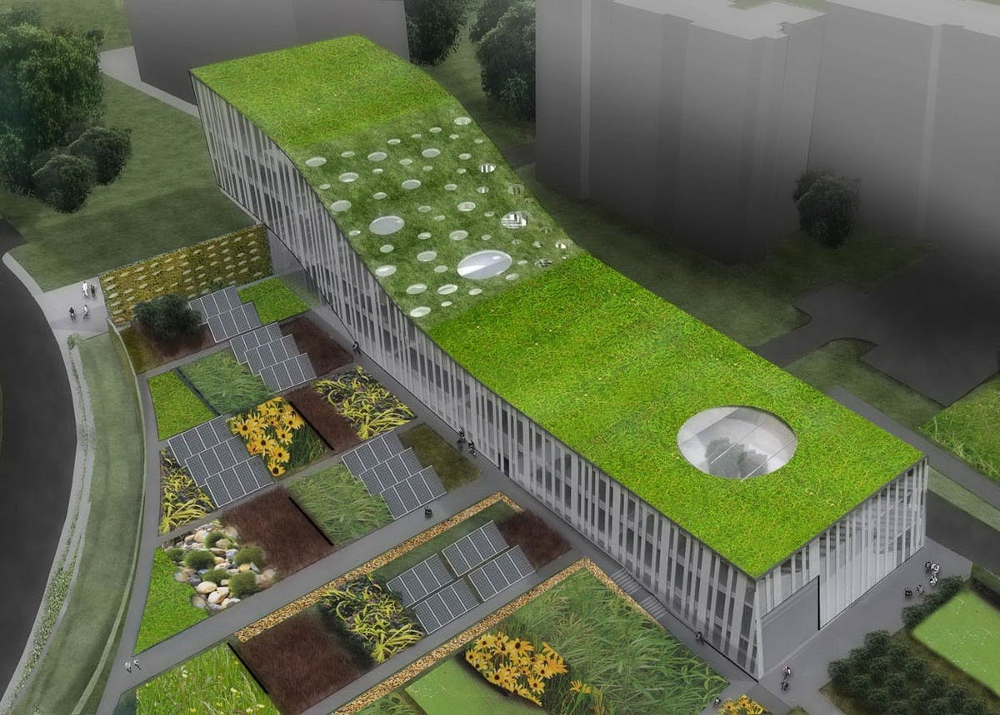
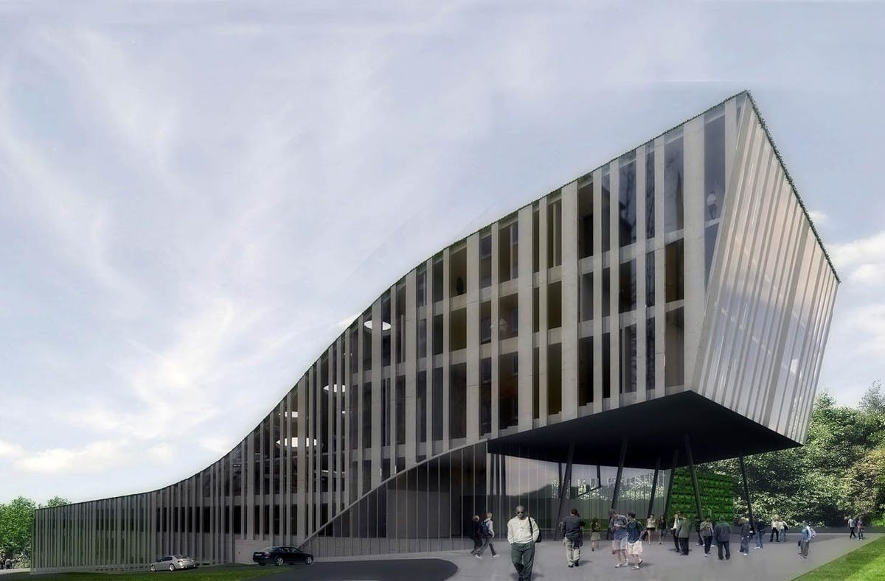
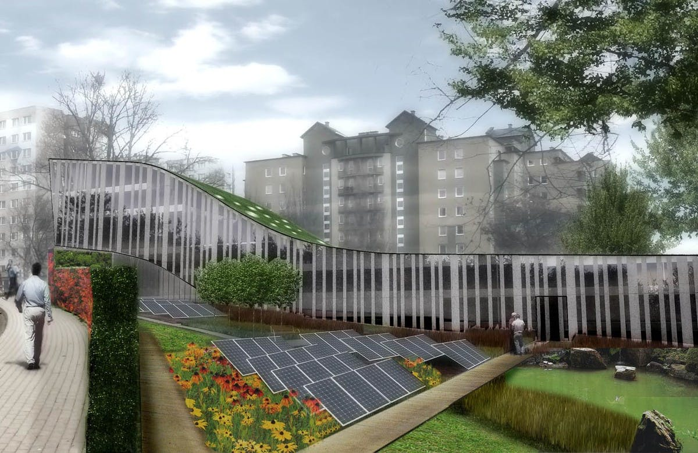
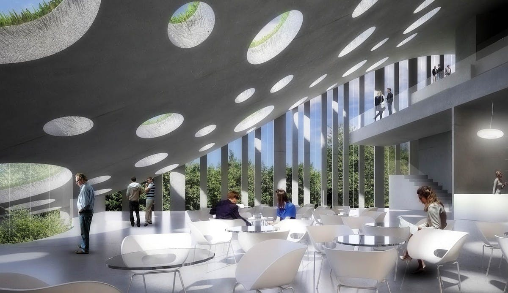

# EcoTech

  

  

    <strong>Klient</strong>
    <b>GROUP ARCH</b>
  

  

    <strong>Typ</strong>
    Budynek usługowy
  

  

    <strong>Powierzchnia</strong>
    5000 m2
  

  

    <strong>Stadium</strong>
    Koncepcja konkursowa
  

  

    <strong>Lokalizacja</strong>
    Lublin
  

  

    <strong>Realizacja</strong>
    2010
  

  

    <strong>Wykonawca</strong>
    <b></b>
  

---

## O projekcie

Projekt centrum edukacji ekologicznej w Lublinie, łączący funkcje biurowe, laboratoria oraz moduł ekspozycyjny z częścią wystawienniczą. Bryła budynku została zaprojektowana w sposób czytelny i funkcjonalny, z wyraźnym podziałem na strefy edukacyjne, badawcze i administracyjne, umożliwiając płynne poruszanie się użytkowników i elastyczne wykorzystanie przestrzeni ekspozycyjnej. Obiekt podkreśla współczesny charakter inwestycji, integrując funkcjonalność z atrakcyjną prezentacją treści edukacyjnych.

## Zakres prac pracowni IA

- Projekt koncepcyjny

## Galeria

  <figure class="gallery-item">
    <a href="../../img/portfolio/ecotech/1.jpg" class="glightbox" data-gallery="portfolio-ecotech">
      
      <figcaption>1</figcaption>
    </a>
  </figure>
  <figure class="gallery-item">
    <a href="../../img/portfolio/ecotech/2.jpg" class="glightbox" data-gallery="portfolio-ecotech">
      
      <figcaption>2</figcaption>
    </a>
  </figure>
  <figure class="gallery-item">
    <a href="../../img/portfolio/ecotech/3.jpg" class="glightbox" data-gallery="portfolio-ecotech">
      
      <figcaption>3</figcaption>
    </a>
  </figure>
  <figure class="gallery-item">
    <a href="../../img/portfolio/ecotech/4.jpg" class="glightbox" data-gallery="portfolio-ecotech">
      
      <figcaption>4</figcaption>
    </a>
  </figure>

---

  <a href="../" class="kategoria-link wiedza-back">Powrót do portfolio</a>

