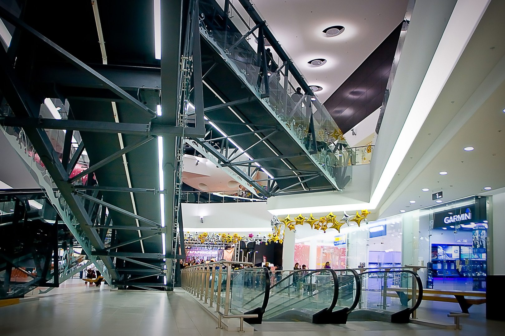
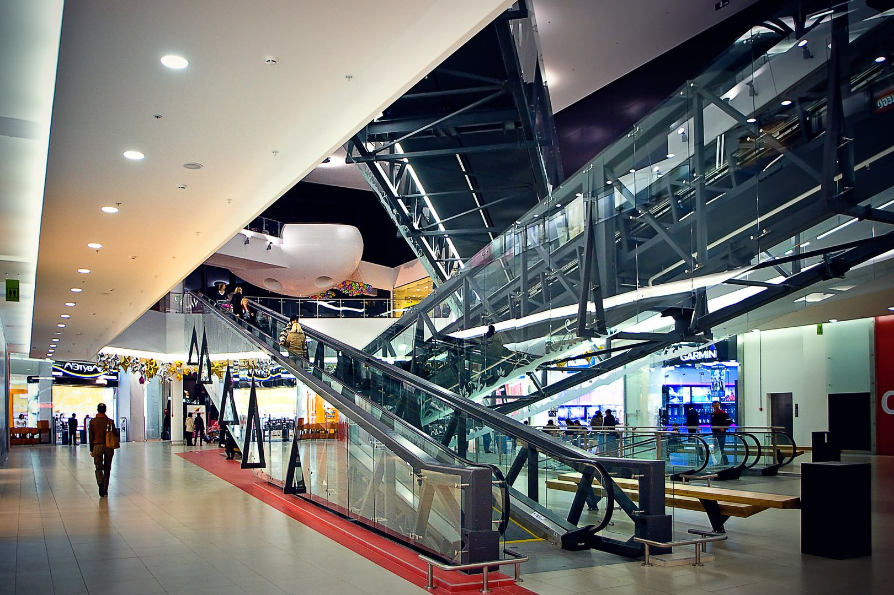
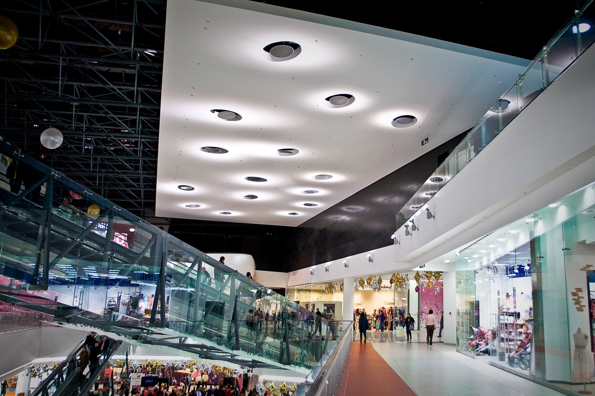
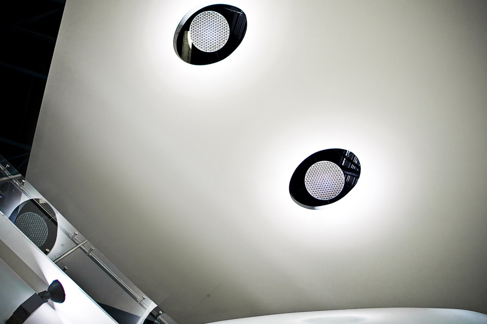
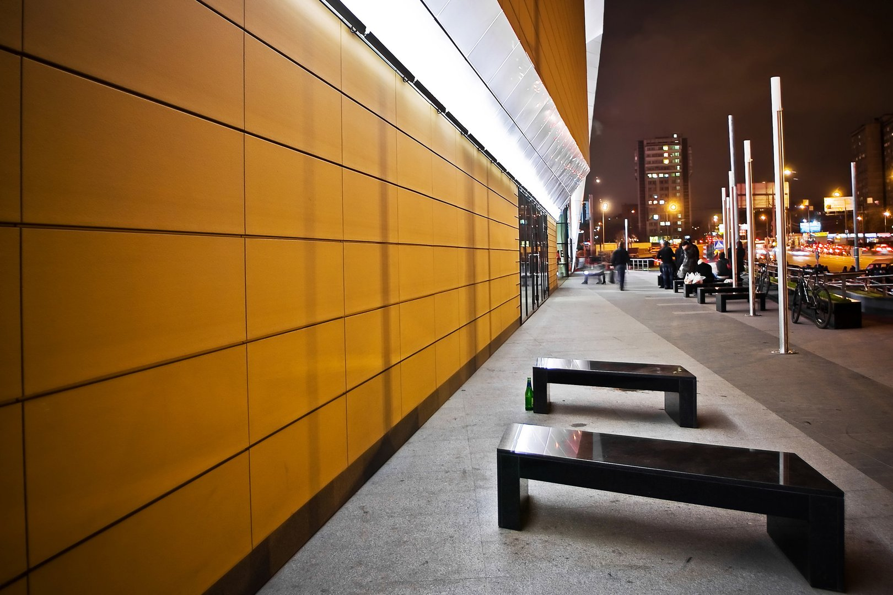
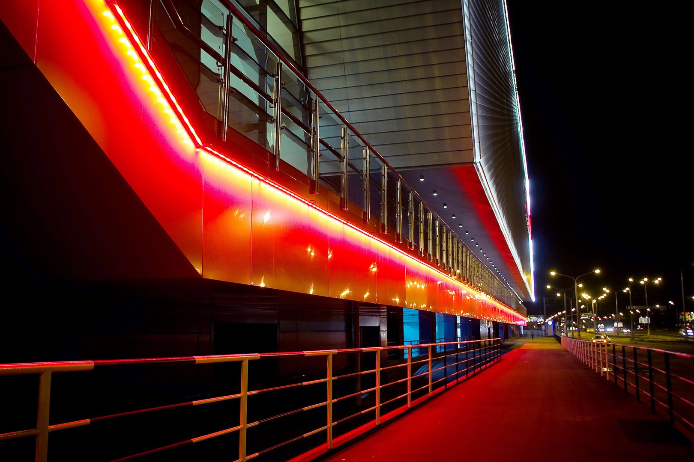
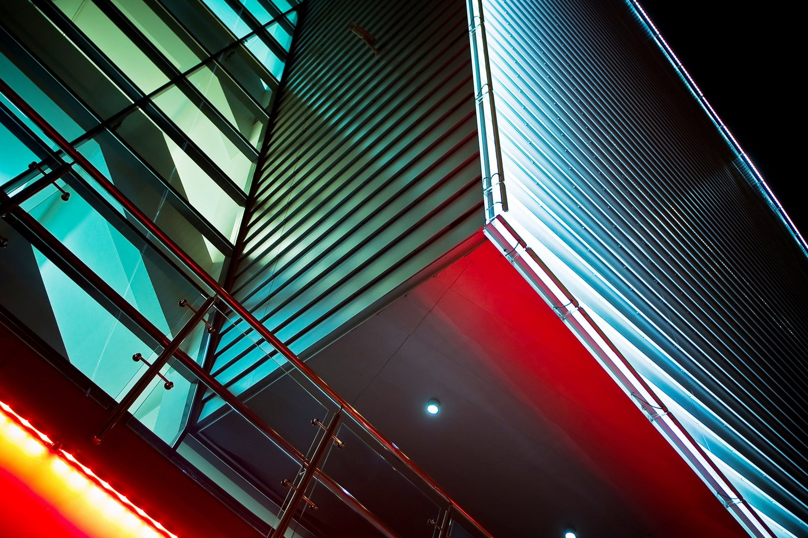
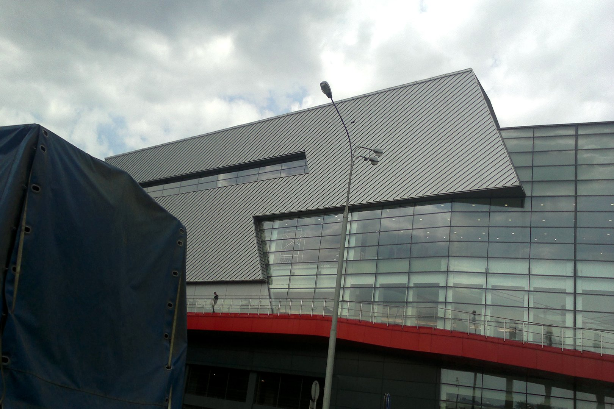

# Gagarinski center

  

  

    <strong>Klient</strong>
    <b>BLANK ARCHITECTS</b>
  

  

    <strong>Typ</strong>
    Budynek handlowy
  

  

    <strong>Powierzchnia</strong>
    208000 m2 
  

  

    <strong>Stadium</strong>
    Realizacja
  

  

    <strong>Lokalizacja</strong>
    Moskwa
  

  

    <strong>Realizacja</strong>
    2010
  

  

    <strong>Wykonawca</strong>
    <b>EUROSTROY</b>
  

---

## O projekcie

Wielokondygnacyjne centrum handlowe zlokalizowane w centrum Moskwy, łączące funkcje handlowe, gastronomiczne i biurowe. Obiekt obejmuje dwukondygnacyjny hipermarket, strefę restauracyjną oraz kompleks biur, połączony przestrzennie z pozostałymi częściami centrum. Integralną częścią inwestycji jest trzykondygnacyjny podziemny parking na 2700 miejsc, zapewniający sprawną obsługę komunikacyjną całego kompleksu. Bryła budynku została zaprojektowana w sposób czytelny i funkcjonalny, eksponując podział funkcji oraz umożliwiając wygodne poruszanie się klientów i pracowników.

## Zakres prac pracowni IA

- Piotr Choromański (IA) jako LEAD Architect wraz wieloosobowym zespołem Group-Arch
- Projekt koncepcyjny
- Projekt budowlany
- Projekt Wykonawczy
- Koordynacja międzybranzowa
- Dokumentacja 2D

## Galeria

  <figure class="gallery-item">
    <a href="../../img/portfolio/gagarinski/Ashan_0024.jpg" class="glightbox" data-gallery="portfolio-gagarinski">
      
      <figcaption>Ashan 0024</figcaption>
    </a>
  </figure>
  <figure class="gallery-item">
    <a href="../../img/portfolio/gagarinski/Ashan_0055.jpg" class="glightbox" data-gallery="portfolio-gagarinski">
      
      <figcaption>Ashan 0055</figcaption>
    </a>
  </figure>
  <figure class="gallery-item">
    <a href="../../img/portfolio/gagarinski/Ashan_0063.jpg" class="glightbox" data-gallery="portfolio-gagarinski">
      
      <figcaption>Ashan 0063</figcaption>
    </a>
  </figure>
  <figure class="gallery-item">
    <a href="../../img/portfolio/gagarinski/Ashan_0090.jpg" class="glightbox" data-gallery="portfolio-gagarinski">
      
      <figcaption>Ashan 0090</figcaption>
    </a>
  </figure>
  <figure class="gallery-item">
    <a href="../../img/portfolio/gagarinski/Ashan_0128.jpg" class="glightbox" data-gallery="portfolio-gagarinski">
      
      <figcaption>Ashan 0128</figcaption>
    </a>
  </figure>
  <figure class="gallery-item">
    <a href="../../img/portfolio/gagarinski/Ashan_0165.jpg" class="glightbox" data-gallery="portfolio-gagarinski">
      
      <figcaption>Ashan 0165</figcaption>
    </a>
  </figure>
  <figure class="gallery-item">
    <a href="../../img/portfolio/gagarinski/Ashan_0170.jpg" class="glightbox" data-gallery="portfolio-gagarinski">
      
      <figcaption>Ashan 0170</figcaption>
    </a>
  </figure>
  <figure class="gallery-item">
    <a href="../../img/portfolio/gagarinski/Ashan_0171.jpg" class="glightbox" data-gallery="portfolio-gagarinski">
      
      <figcaption>Ashan 0171</figcaption>
    </a>
  </figure>

---

  <a href="../" class="kategoria-link wiedza-back">Powrót do portfolio</a>

