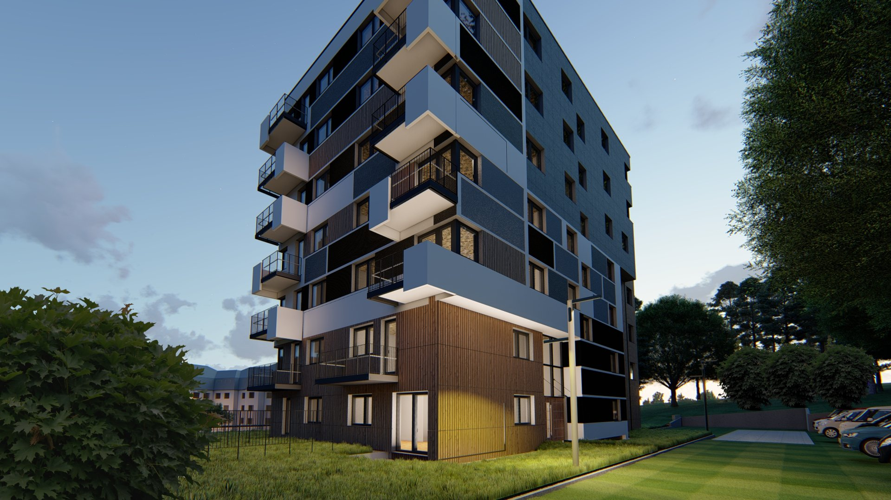
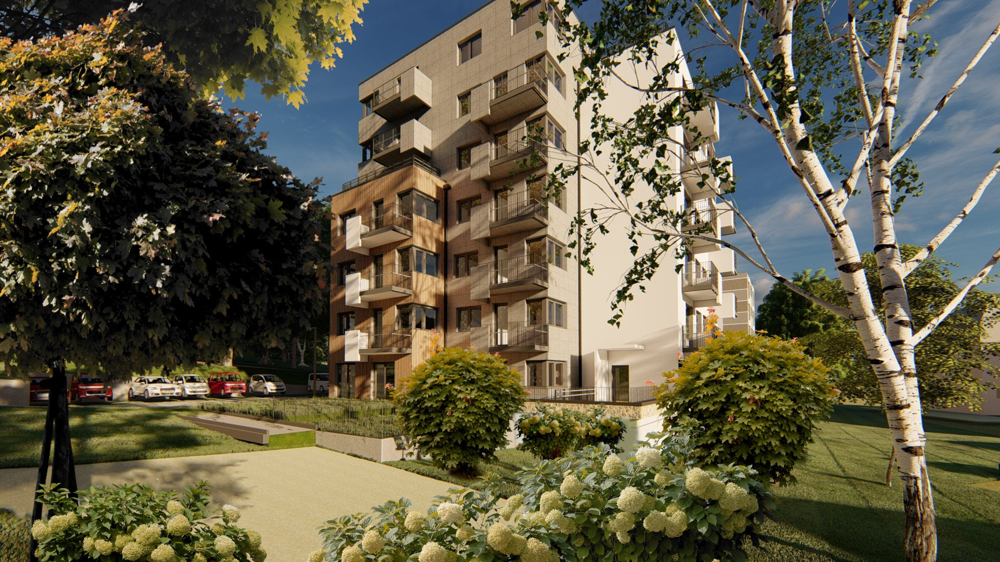
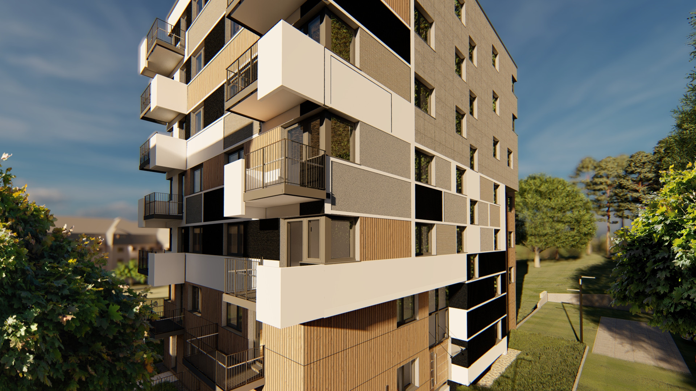
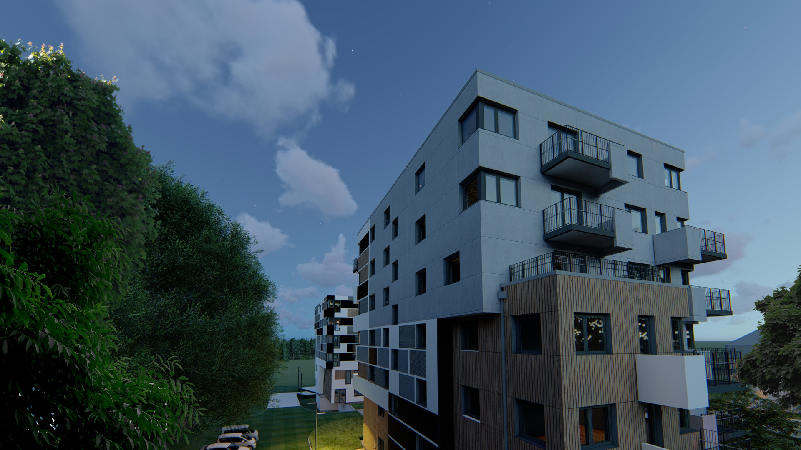
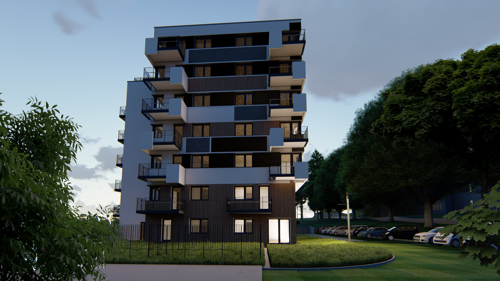

# Kudowa-apartamenty

  

  

    <strong>Klient</strong>
    <b>	IG APARTMENTS</b>
  

  

    <strong>Typ</strong>
    Budynek wielorodzinny
  

  

    <strong>Powierzchnia</strong>
    4800 m2
  

  

    <strong>Stadium</strong>
    Koncpecja wielobranżowa
  

  

    <strong>Lokalizacja</strong>
    Kudowa-Zdrój
  

  

    <strong>Realizacja</strong>
    2018
  

  

    <strong>Wykonawca</strong>
    <b></b>
  

---

## O projekcie

Wielokondygnacyjny budynek wielorodzinny w centrum Kudowy‑Zdrój, składający się z dwóch brył połączonych podziemnym parkingiem. Obiekt posiada wyraźnie wydzielone segmenty funkcjonalne, z balkonami i loggiami porządkującymi elewacje oraz zapewniającymi doświetlenie mieszkań. Bryła uwzględnia zróżnicowane układy mieszkań, a proporcje i stonowana paleta materiałów podkreślają współczesny charakter budynku w miejskim kontekście uzdrowiska.

## Zakres prac pracowni IA

- Koncpecja wielobranżowa

## Galeria

  <figure class="gallery-item">
    <a href="../../img/portfolio/kudowa0/1.jpg" class="glightbox" data-gallery="portfolio-kudowa0">
      
      <figcaption>1</figcaption>
    </a>
  </figure>
  <figure class="gallery-item">
    <a href="../../img/portfolio/kudowa0/2.jpg" class="glightbox" data-gallery="portfolio-kudowa0">
      
      <figcaption>2</figcaption>
    </a>
  </figure>
  <figure class="gallery-item">
    <a href="../../img/portfolio/kudowa0/3.jpg" class="glightbox" data-gallery="portfolio-kudowa0">
      
      <figcaption>3</figcaption>
    </a>
  </figure>
  <figure class="gallery-item">
    <a href="../../img/portfolio/kudowa0/4.jpg" class="glightbox" data-gallery="portfolio-kudowa0">
      
      <figcaption>4</figcaption>
    </a>
  </figure>
  <figure class="gallery-item">
    <a href="../../img/portfolio/kudowa0/5.jpg" class="glightbox" data-gallery="portfolio-kudowa0">
      
      <figcaption>5</figcaption>
    </a>
  </figure>

---

  <a href="../" class="kategoria-link wiedza-back">Powrót do portfolio</a>

