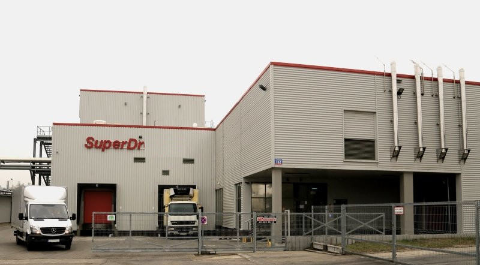
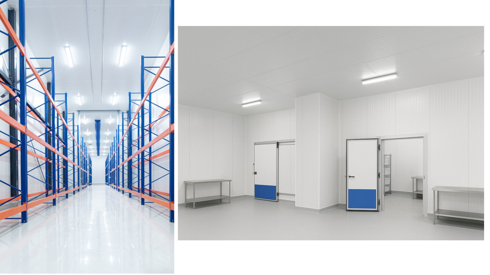
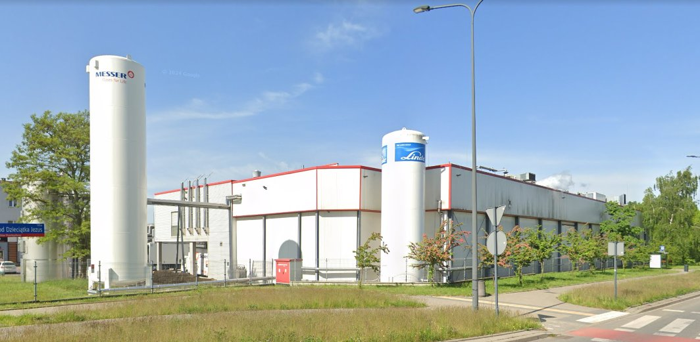

# Budynek produkcyjny

  

  

    <strong>Klient</strong>
    <b>SUPERDROB</b>
  

  

    <strong>Typ</strong>
    Budynek produkcyjny
  

  

    <strong>Powierzchnia</strong>
    5125 m2 
  

  

    <strong>Stadium</strong>
    Realizacja
  

  

    <strong>Lokalizacja</strong>
    Łódź
  

  

    <strong>Realizacja</strong>
    2013
  

  

    <strong>Wykonawca</strong>
    <b>EIFFAGE BUDOWNICTWO</b>
  

---

## O projekcie

Zakład produkcji spożywczej produktów gotowych, łączący funkcje produkcyjne, magazynowe i biurowe. Obiekt obejmuje halę produkcyjną, mroźnię oraz magazyn mroźniczy wysokiego składowania, umożliwiający efektywne przechowywanie produktów. Część biurowa i socjalna została wydzielona w obrębie obiektu, tworząc czytelny układ funkcjonalny wspierający procesy technologiczne i logistykę zakładu. Bryła budynku została zaprojektowana w sposób czytelny i funkcjonalny, podkreślając hierarchię przestrzeni produkcyjnej i magazynowej.

**Zespół autorski:** FORT POLSKA - konstrukcja

## Zakres prac pracowni IA

- Projekt koncepcyjny
- Projekt budowlany
- Projekt Wykonawczy
- Koordynacja międzybranzowa
- LOD350-400

## Galeria

  <figure class="gallery-item">
    <a href="../../img/portfolio/lodz/000_2013-02-20 08.32.15.jpg" class="glightbox" data-gallery="portfolio-lodz">
      
      <figcaption>000 2013 02 20 08.32.15</figcaption>
    </a>
  </figure>
  <figure class="gallery-item">
    <a href="../../img/portfolio/lodz/00_2013-02-20 08.34.09.jpg" class="glightbox" data-gallery="portfolio-lodz">
      
      <figcaption>00 2013 02 20 08.34.09</figcaption>
    </a>
  </figure>
  <figure class="gallery-item">
    <a href="../../img/portfolio/lodz/100.jpg" class="glightbox" data-gallery="portfolio-lodz">
      
      <figcaption>100</figcaption>
    </a>
  </figure>
  <figure class="gallery-item">
    <a href="../../img/portfolio/lodz/101lodz.jpg" class="glightbox" data-gallery="portfolio-lodz">
      
      <figcaption>101Lodz</figcaption>
    </a>
  </figure>
  <figure class="gallery-item">
    <a href="../../img/portfolio/lodz/2013-02-20 08.05.27.jpg" class="glightbox" data-gallery="portfolio-lodz">
      
      <figcaption>2013 02 20 08.05.27</figcaption>
    </a>
  </figure>
  <figure class="gallery-item">
    <a href="../../img/portfolio/lodz/2013-02-20 08.09.27.jpg" class="glightbox" data-gallery="portfolio-lodz">
      
      <figcaption>2013 02 20 08.09.27</figcaption>
    </a>
  </figure>
  <figure class="gallery-item">
    <a href="../../img/portfolio/lodz/2013-02-20 08.10.28.jpg" class="glightbox" data-gallery="portfolio-lodz">
      
      <figcaption>2013 02 20 08.10.28</figcaption>
    </a>
  </figure>
  <figure class="gallery-item">
    <a href="../../img/portfolio/lodz/lpk.jpg" class="glightbox" data-gallery="portfolio-lodz">
      
      <figcaption>Lpk</figcaption>
    </a>
  </figure>

---

  <a href="../" class="kategoria-link wiedza-back">Powrót do portfolio</a>

