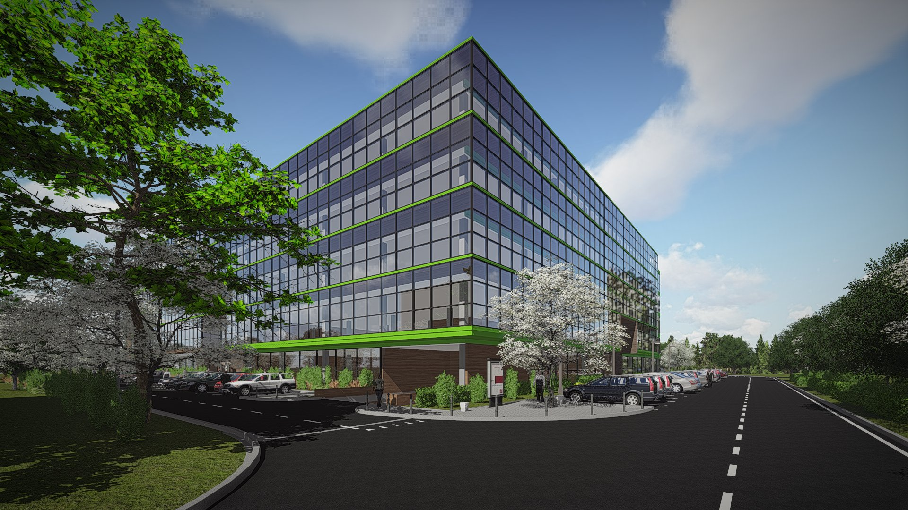
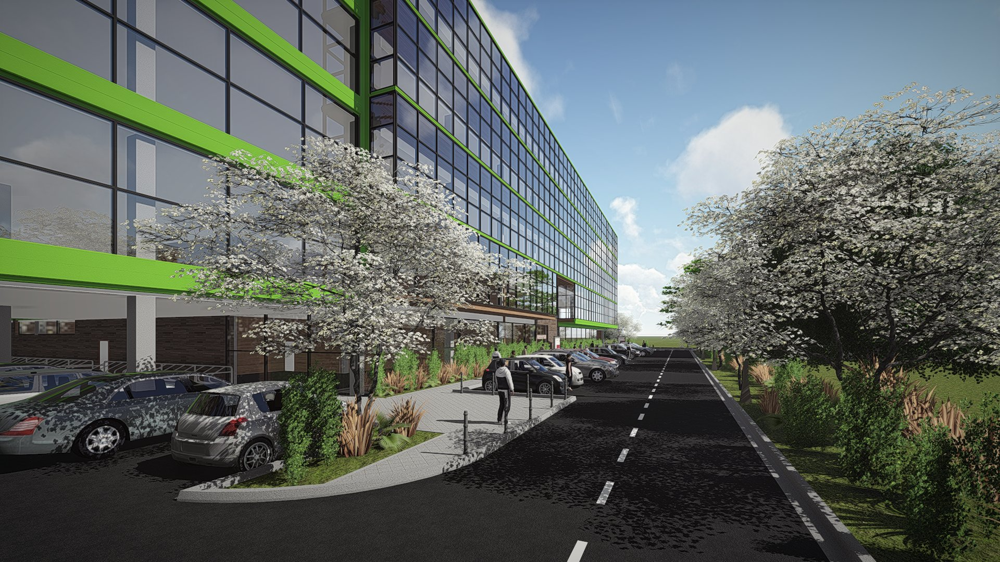
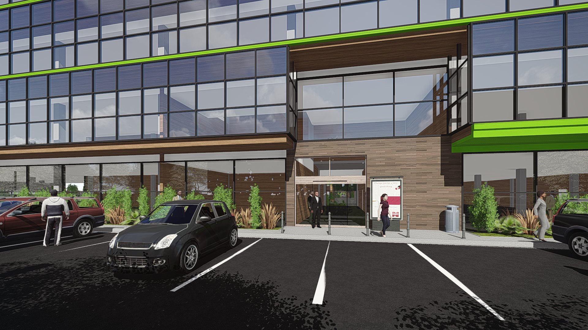
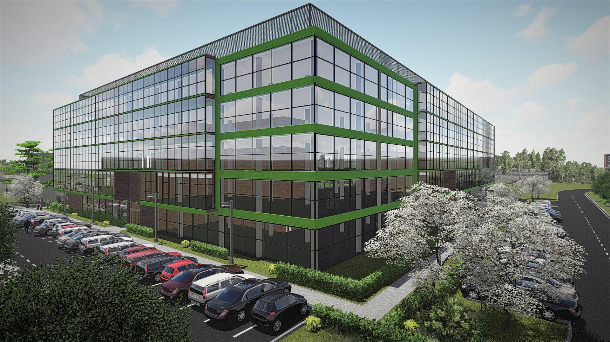
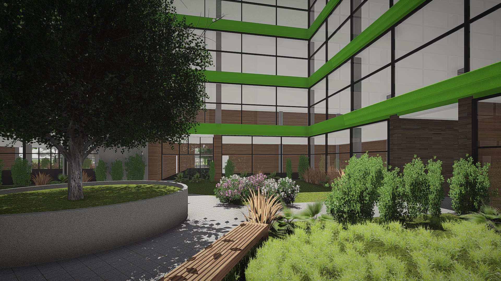

# PaprotnaPark

  

  

    <strong>Klient</strong>
    <b>INVEST GRUPA</b>
  

  

    <strong>Typ</strong>
    Budynek biurowy
  

  

    <strong>Powierzchnia</strong>
    17500 m2 
  

  

    <strong>Stadium</strong>
    Koncepcja
  

  

    <strong>Lokalizacja</strong>
    Wrocław
  

  

    <strong>Realizacja</strong>
    2019
  

  

    <strong>Wykonawca</strong>
    <b></b>
  

---

## O projekcie

Budynek biurowy o współczesnej, wyrazistej bryle, kształtowanej przez dynamiczne linie dachu i zróżnicowaną wysokość poszczególnych części obiektu. Kompozycja architektoniczna opiera się na zestawieniu przeszklonych elewacji z pełnymi płaszczyznami okładzin, co podkreśla podział funkcjonalny budynku i nadaje mu lekki, nowoczesny charakter. Duże przeszklenia zapewniają dobre doświetlenie przestrzeni biurowych, a rytmiczny układ podziałów elewacyjnych porządkuje skalę obiektu. Forma budynku została ukształtowana w sposób podkreślający reprezentacyjny charakter funkcji biurowej oraz czytelność stref wejściowych.

## Zakres prac pracowni IA

- Projekt koncepcyjny

## Galeria

  <figure class="gallery-item">
    <a href="../../img/portfolio/paprotna/01.jpg" class="glightbox" data-gallery="portfolio-paprotna">
      
      <figcaption>01</figcaption>
    </a>
  </figure>
  <figure class="gallery-item">
    <a href="../../img/portfolio/paprotna/02.jpg" class="glightbox" data-gallery="portfolio-paprotna">
      
      <figcaption>02</figcaption>
    </a>
  </figure>
  <figure class="gallery-item">
    <a href="../../img/portfolio/paprotna/03.jpg" class="glightbox" data-gallery="portfolio-paprotna">
      
      <figcaption>03</figcaption>
    </a>
  </figure>
  <figure class="gallery-item">
    <a href="../../img/portfolio/paprotna/04.jpg" class="glightbox" data-gallery="portfolio-paprotna">
      
      <figcaption>04</figcaption>
    </a>
  </figure>
  <figure class="gallery-item">
    <a href="../../img/portfolio/paprotna/05.jpg" class="glightbox" data-gallery="portfolio-paprotna">
      
      <figcaption>05</figcaption>
    </a>
  </figure>

---

  <a href="../" class="kategoria-link wiedza-back">Powrót do portfolio</a>

