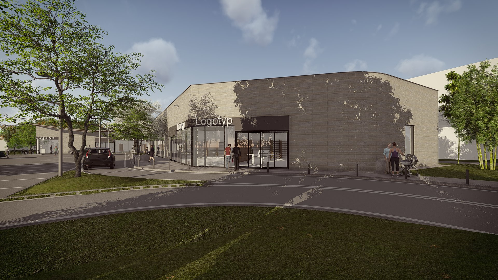
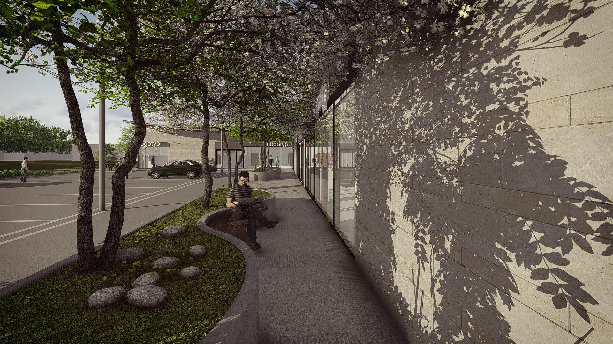
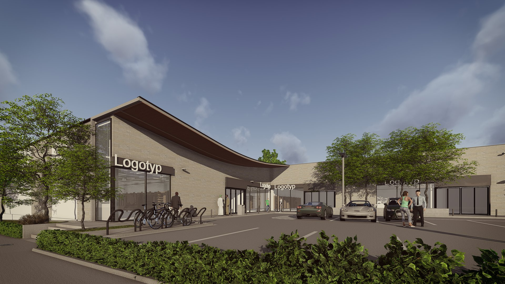
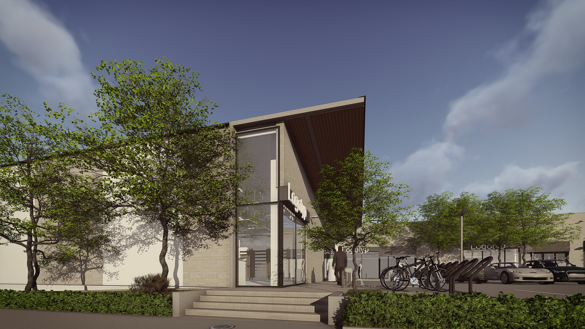

# RetailPark

  

  

    <strong>Klient</strong>
    <b>INVEST GRUPA</b>
  

  

    <strong>Typ</strong>
    Budynek handlowy
  

  

    <strong>Powierzchnia</strong>
    4024 m2 
  

  

    <strong>Stadium</strong>
    Koncepcja
  

  

    <strong>Lokalizacja</strong>
    Piotrków Trybunalski
  

  

    <strong>Realizacja</strong>
    2017
  

  

    <strong>Wykonawca</strong>
    <b></b>
  

---

## O projekcie

Nowoczesny park handlowy o czytelnej, modułowej strukturze architektonicznej, zaprojektowany jako zespół parterowych pawilonów usługowo-handlowych z dominantą dużych przeszkleń witrynowych. Forma obiektu utrzymana jest w minimalistycznej, współczesnej stylistyce, z zastosowaniem prostych podziałów elewacyjnych i stonowanej palety materiałowej. Układ przestrzenny opiera się na wygodnej komunikacji pieszej pomiędzy lokalami oraz funkcjonalnym systemie obsługi komunikacji samochodowej, w tym rozbudowanej strefie parkingowej. Projekt zakłada elastyczność aranżacji powierzchni najmu oraz integrację obiektu z otoczeniem poprzez uporządkowaną przestrzeń publiczną i elementy zieleni.

## Zakres prac pracowni IA

- Projekt koncepcyjny

## Galeria

  <figure class="gallery-item">
    <a href="../../img/portfolio/piotrkow/01.jpg" class="glightbox" data-gallery="portfolio-piotrkow">
      
      <figcaption>01</figcaption>
    </a>
  </figure>
  <figure class="gallery-item">
    <a href="../../img/portfolio/piotrkow/02.jpg" class="glightbox" data-gallery="portfolio-piotrkow">
      
      <figcaption>02</figcaption>
    </a>
  </figure>
  <figure class="gallery-item">
    <a href="../../img/portfolio/piotrkow/03.jpg" class="glightbox" data-gallery="portfolio-piotrkow">
      
      <figcaption>03</figcaption>
    </a>
  </figure>
  <figure class="gallery-item">
    <a href="../../img/portfolio/piotrkow/04.jpg" class="glightbox" data-gallery="portfolio-piotrkow">
      
      <figcaption>04</figcaption>
    </a>
  </figure>

---

  <a href="../" class="kategoria-link wiedza-back">Powrót do portfolio</a>

