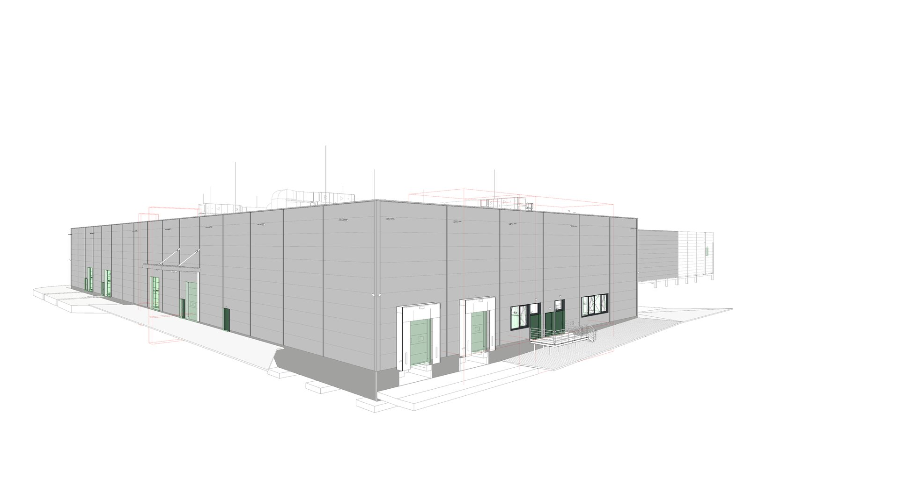

# Budynek produkcyjny

  

  

    <strong>Klient</strong>
    <b>KOMA TOMASZ MAGIERA</b>
  

  

    <strong>Typ</strong>
    Budynek produkcyjny
  

  

    <strong>Powierzchnia</strong>
    5 500 m²
  

  

    <strong>Stadium</strong>
    W przygotowaniu do realizacji
  

  

    <strong>Lokalizacja</strong>
    Kamienna góra
  

  

    <strong>Realizacja</strong>
    2026
  

  

    <strong>Wykonawca</strong>
    <b>TAKENAKA</b>
  

---

## O projekcie

Obiekt produkcyjno-magazynowy z zapleczem biurowo-socjalnym, zaprojektowany z myślą o sprawnej organizacji procesów produkcyjnych, konfekcjonowania i logistyki. Architektura budynku opiera się na prostej, nowoczesnej formie przemysłowej, w której poszczególne strefy funkcjonalne zostały podporządkowane specyfice działalności zakładu.

Główna część obiektu mieści przestrzenie produkcyjne i magazynowe, umożliwiające realizację procesów związanych z przygotowaniem, obróbką, kompletowaniem i pakowaniem produktów. Układ funkcjonalny zapewnia odpowiednie warunki do organizacji stanowisk pracy, składowania materiałów oraz sprawnej obsługi przepływu towarów. Istotnym elementem założenia jest również zaplecze logistyczne, wspierające codzienną działalność operacyjną przedsiębiorstwa.

Część biurowo-socjalna stanowi integralny element kompleksu, zapewniając zaplecze administracyjne i pracownicze. Całość tworzy funkcjonalne środowisko pracy, w którym rozwiązania przestrzenne i architektoniczne odpowiadają wymaganiom nowoczesnego zakładu produkcyjnego, łączącego działalność wytwórczą, usługową i magazynową.

**Zespół autorski:** KOMA - konstrukcja, MKJANURA - instalacje sanitarne, MKJANURA - instalacje elektryczne  i teletechniczne

## Zakres prac pracowni IA

- Projekt wykonawczy
- LOD350

## Galeria

  <figure class="gallery-item">
    <a href="../../img/portfolio/produkcja4/01.jpg" class="glightbox" data-gallery="portfolio-produkcja4">
      
      <figcaption>01</figcaption>
    </a>
  </figure>

---

  <a href="../" class="kategoria-link wiedza-back">Powrót do portfolio</a>

