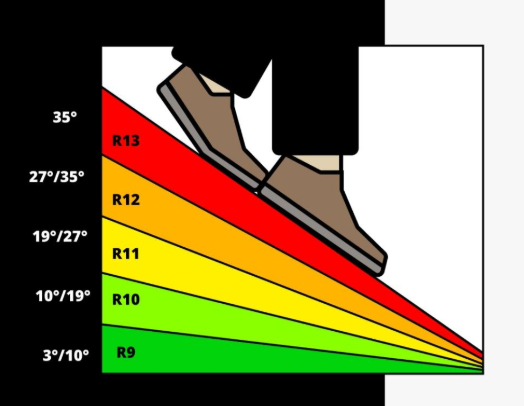

<!--
================================================================================
INSTRUKCJA EDYCJI ARTYKUŁU
================================================================================

HERO (główne zdjęcie):
- Wrzuć zdjęcie jako: docs/img/wiedza/SLUG/hero.jpg
- Wyświetli się automatycznie pod tytułem
- Pojawi się też w miniaturkach na liście artykułów
- Brak hero.jpg = brak zdjęcia głównego

ZDJĘCIA W TREŚCI:
- Placeholdery są na końcu pliku (przed "Powiązane artykuły")
- Wytnij, wklej gdzie chcesz, odkomentuj (usuń < ! - - i - - >)
- Zmień opis i numer pliku
- Wrzuć zdjęcia do: docs/img/wiedza/SLUG/
- Kompresja automatyczna przy renderze strony
- Rozmiar: { width="500" } lub { width="50%" }

DIAGRAMY (tylko szablony B i C):
- Edytuj tekst w bloku mermaid
- Zmień placeholdery: KROK 1, WYZWANIE, itd.
- Podgląd: https://mermaid.live

BLOKI WYRÓŻNIONE (admonitions):
- !!! note/tip/warning/danger/info/example "Tytuł"
- Treść z wcięciem 4 spacji (zaznacz + Tab)
- ??? = zwijane, ???+ = rozwinięte domyślnie

STRUKTURA:
- Wypełnij sekcje oznaczone [w nawiasach kwadratowych]
- Zachowaj hierarchię nagłówków (H2, H3)
- Usuń sekcje których nie potrzebujesz

STATUS W CSV:
- new = do wygenerowania
- draft = w edycji (niewidoczny na stronie)
- published = widoczny na stronie

PODGLĄD LOKALNY (tylko published):
python -m mkdocs serve

PODGLĄD Z DRAFTAMI (Windows):
set SHOW_DRAFTS=1 && python -m mkdocs serve

DEPLOY:
python -m mkdocs gh-deploy --clean --force
================================================================================
-->

# Posadzki żywiczne w przemyśle

{{ wiedza_hero("posadzki-zywiczne-przemysle") }}

Rodzaje systemów żywicznych stosowanych jako wykończenie posadzek przemysłowych oraz ich podstawowe właściwości użytkowe

---

## Co to jest?

Posadzki żywiczne to warstwy ochronne i dekoracyjne wykonywane z żywic syntetycznych, takich jak epoksydowe, poliuretanowe lub MMA, stosowane na powierzchniach przemysłowych w celu zwiększenia trwałości, odporności chemicznej i mechanicznej podłoża.

!!! info "Definicja"
    Posadzka żywiczna to chemicznie utwardzona, jednorodna warstwa syntetyczna stosowana jako wykończenie powierzchni podłogowych, odporna na ścieranie, chemikalia i obciążenia mechaniczne.

## Dlaczego to ważne?

Posadzki żywiczne zapewniają bezpieczeństwo i długowieczność powierzchni przemysłowych. Chronią beton przed uszkodzeniami, ułatwiają utrzymanie czystości i pozwalają dostosować właściwości podłoża do środowiska pracy i rodzaju obciążeń.

### Korzyści

| Korzyść | Opis |
|---------|------|
| Odporność mechaniczna | Wytrzymują obciążenia statyczne i dynamiczne oraz intensywny ruch transportu wewnętrznego. |
| Odporność chemiczna | Chronią posadzkę przed olejami, smarami, kwasami i innymi substancjami chemicznymi. |
| Łatwość utrzymania | Gładka i szczelna powierzchnia ułatwia czyszczenie i spełnia wymagania higieniczne. |

## Jak to zrobić?

Proces wykonania posadzki żywicznej wymaga właściwego przygotowania podłoża, doboru systemu żywicznego oraz prawidłowej aplikacji warstwy ochronnej.

## Jaka żywica?

Dobór żywicy do posadzki przemysłowej zależy od obciążeń, środowiska pracy oraz wymagań eksploatacyjnych. W praktyce stosuje się trzy główne typy żywic: epoksydowe, poliuretanowe i MMA (metakrylan metylu). Każdy typ ma swoje zalety i ograniczenia.

!!! note "Rodzaje żywic"

    ### Żywica epoksydowa
    - **Zalety:** bardzo dobra przyczepność do betonu, wysoka odporność mechaniczna, gładka i szczelna powierzchnia  
    - **Ograniczenia:** średnia odporność UV, może żółknąć w świetle słonecznym  
    - **Zastosowanie:** hale produkcyjne, magazyny, laboratoria, strefy suche i średnio wilgotne  

    ### Żywica poliuretanowa
    - **Zalety:** odporność chemiczna i mechaniczna, wysoka elastyczność, dobra odporność UV  
    - **Ograniczenia:** nieco trudniejsza aplikacja, wrażliwa na wilgotne podłoże przy nakładaniu  
    - **Zastosowanie:** strefy mokre, myjnie przemysłowe, posadzki z ruchem pieszym i wózkowym, ekspozycja na UV  

    ### Żywica MMA
    - **Zalety:** szybki czas utwardzania, odporność na niskie temperatury, dobra odporność chemiczna  
    - **Ograniczenia:** wyższy koszt materiału, intensywny zapach podczas aplikacji  
    - **Zastosowanie:** posadzki szybkorozkładowe, remonty istniejących posadzek, miejsca wymagające szybkiego przywrócenia do eksploatacji  
### Krok 1: Przygotowanie podłoża

Przygotowanie podłoża to etap krytyczny dla przyczepności i trwałości powłoki żywicznej. Skupia się na parametrach **mechanicznych i fizycznych podłoża**, niezależnie od chemii żywicy.

- **Oczyszczenie powierzchni:** usunięcie kurzu, tłuszczu, olejów i luźnych fragmentów.  
- **Stabilizacja i naprawy:** uzupełnienie ubytków, spękań, wzmocnienie struktury betonu w razie potrzeby.  
- **Szlifowanie lub frezowanie:** poprawa przyczepności poprzez zwiększenie chropowatości powierzchni.  
- **Suszenie i kontrola wilgotności:** podłoże powinno być suche i w dopuszczalnym zakresie wilgotności zgodnie ze specyfikacją producenta żywicy.  
- **Gruntowanie:** stosowane, jeśli producent systemu wymaga zastosowania preparatu poprawiającego przyczepność żywicy.  

> **Zasada inżynierska:** prawidłowe przygotowanie podłoża jest podstawą trwałości posadzki – błędy w tym kroku mogą skutkować odspajaniem lub pękaniem powłoki, niezależnie od jakości samej żywicy.

### Krok 2: Dobór systemu żywicznego

Na podstawie oceny warunków eksploatacji i środowiska pracy określ, który system żywiczny jest odpowiedni:

- Zidentyfikuj **typ obciążeń** (np. statyczne, dynamiczne, chemiczne).
- Dobierz żywicę zgodnie z wymaganiami:
  - **Epoksydowa** – preferowana dla ogólnych obciążeń mechanicznych i chemicznych w strefach suchych lub umiarkowanych.  
  - **Poliuretanowa** – wybierana tam, gdzie jest większa elastyczność, odporność UV lub wilgotność.  
  - **MMA / Poliurea** – tam, gdzie ważny jest **czas instalacji i szybkie utwardzanie** lub ekstremalne warunki pracy.  
- Zdefiniuj **parametry wykonawcze systemu**: grubość powłoki, wykończenie powierzchni, klasę antypoślizgowości.

Dzięki temu wykonawca uzyska **jasną i jednoznaczną decyzję** w specyfikacji, bez powtórzenia definicji i właściwości materiałów.
### Krok 3: Aplikacja i wykończenie

Po przygotowaniu podłoża następuje **aplikacja powłoki żywicznej**, która jest procesem ściśle chemicznym i technologicznym. Tutaj decydują parametry **receptury producenta**, a nie tylko cechy mechaniczne podłoża.

- **Receptura producenta:** skład chemiczny, proporcje komponentów, czas reakcji i utwardzania są krytyczne. Błędy w mieszaniu lub zastosowaniu niewłaściwych dodatków mogą prowadzić do awarii powłoki.  
- **Parametry aplikacji:** temperatura podłoża i powietrza, wilgotność, wentylacja oraz czas otwarcia żywicy muszą być zgodne z zaleceniami producenta.  
- **Technika nakładania:** wałek, rakla lub natrysk zgodnie z instrukcją – kontrola grubości warstwy, równomierności i eliminacja pęcherzyków powietrza.  
- **Efekt końcowy:** powłoka osiąga deklarowane właściwości mechaniczne i chemiczne, odporność ścierną, antypoślizgową oraz wykończenie powierzchni (mat, półmat, połysk).  

> **Zasada inżynierska:** przygotowanie podłoża zapewnia prawidłową przyczepność, natomiast właściwa aplikacja i przestrzeganie receptury producenta gwarantują osiągnięcie wymaganej trwałości i funkcjonalności posadzki.
💡 **Wnioski inżynierskie:** aplikacja posadzki żywicznej to proces chemiczny, nie tylko mechaniczny — każdy system producenta ma swoje specyficzne wymagania i tolerancje. Zachowanie parametrów receptury jest kluczowe dla uzyskania właściwej eksploatacji posadzki.
!!! warning "Uwaga"
    Nieprawidłowe przygotowanie podłoża lub niewłaściwy dobór systemu żywicznego może prowadzić do odspajania się posadzki, powstawania pęknięć i szybkiej utraty właściwości mechanicznych oraz chemicznych.

## Wskazówki dla BIM

W specyfikacji wykończenia żywicznego warto uwzględnić praktyczne parametry, które są jednoznaczne dla wykonawcy i inwestora:  

- **Typ żywicy** – epoksydowa, poliuretanowa, MMA lub hybrydowa  
- **Grubość warstwy** – minimalna i zalecana grubość powłoki w mm  
- **Odporność mechaniczna** – dopuszczalne obciążenia statyczne i dynamiczne  
- **Odporność chemiczna** – lista substancji agresywnych i odporność powierzchni  
- **Właściwości powierzchni** – gładkość, wykończenie (mat/błysk)  

!!! note "Antypoślizgowość"
    - **Klasa R według normy DIN 51130** – określa odporność powierzchni na poślizg:
      - **R9** – powierzchnie lekko śliskie, np. biura, magazyny z niskim ruchem, podłoże suche  
      - **R10** – standardowa odporność, np. hale produkcyjne, lekkie stanowiska pracy z wilgotnym podłożem  
      - **R11** – wyższa odporność, np. miejsca z wodą, olejem, częstym ruchem wózków, rampy  
      - **R12** – bardzo wysoka odporność, np. strefy mokre i tłuste, myjnie przemysłowe, laboratoria  
      - **R13** – najwyższa odporność, np. ekstremalne warunki przemysłowe, podłoża wyjątkowo śliskie
    - **Dodatki antypoślizgowe**: piasek kwarcowy, mikrokulki ceramiczne – stosowane w żywicy w celu zwiększenia klasy R  
    - **W specyfikacji BIM**: warto podać klasę R oraz typ dodatku antypoślizgowego, aby jednoznacznie wskazać wymagane bezpieczeństwo i fakturę powierzchni   
- **Warunki aplikacji** – temperatura, wilgotność, czas utwardzania  
- **Powiązanie z podłożem** – wymagania co do przygotowania betonu lub istniejącej posadzki  

Takie parametry pozwalają jednoznacznie zaplanować prace, dobrać materiały i kontrolować jakość na budowie,
jednocześnie dostarczając inwestorowi klarowne informacje o trwałości i właściwościach posadzki.

{ width="70%" } 
<!-- ZDJĘCIA - odkomentuj i użyj gdzie potrzebujesz w artykule -->

<!--  -->
<!--  -->

---

{{ wiedza_powiazane("posadzki-zywiczne-przemysle") }}

  <a href="../" class="btn btn-outline">Powrót do centrum wiedzy</a>

