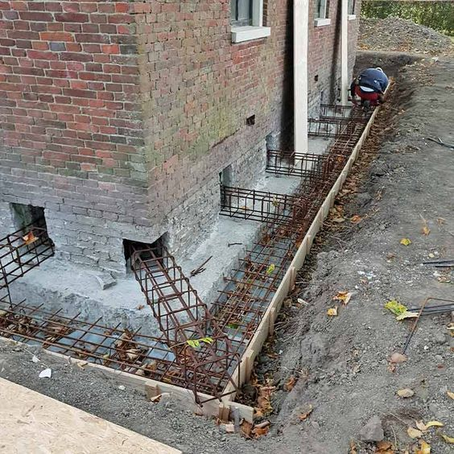

<!--
================================================================================
INSTRUKCJA EDYCJI ARTYKUŁU
================================================================================

HERO (główne zdjęcie):
- Wrzuć zdjęcie jako: docs/img/wiedza/SLUG/hero.jpg
- Wyświetli się automatycznie pod tytułem
- Pojawi się też w miniaturkach na liście artykułów
- Brak hero.jpg = brak zdjęcia głównego

ZDJĘCIA W TREŚCI:
- Placeholdery są na końcu pliku (przed "Powiązane artykuły")
- Wytnij, wklej gdzie chcesz, odkomentuj (usuń < ! - - i - - >)
- Zmień opis i numer pliku
- Wrzuć zdjęcia do: docs/img/wiedza/SLUG/
- Kompresja automatyczna przy renderze strony
- Rozmiar: { width="500" } lub { width="50%" }

DIAGRAMY (tylko szablony B i C):
- Edytuj tekst w bloku mermaid
- Zmień placeholdery: KROK 1, WYZWANIE, itd.
- Podgląd: https://mermaid.live

BLOKI WYRÓŻNIONE (admonitions):
- !!! note/tip/warning/danger/info/example "Tytuł"
- Treść z wcięciem 4 spacji (zaznacz + Tab)
- ??? = zwijane, ???+ = rozwinięte domyślnie

STRUKTURA:
- Wypełnij sekcje oznaczone [w nawiasach kwadratowych]
- Zachowaj hierarchię nagłówków (H2, H3)
- Usuń sekcje których nie potrzebujesz

STATUS W CSV:
- new = do wygenerowania
- draft = w edycji (niewidoczny na stronie)
- published = widoczny na stronie

PODGLĄD LOKALNY (tylko published):
python -m mkdocs serve

PODGLĄD Z DRAFTAMI (Windows):
set SHOW_DRAFTS=1 && python -m mkdocs serve

DEPLOY:
python -m mkdocs gh-deploy --clean --force
================================================================================
-->
# Przywracanie wytrzymałości konstrukcji przemysłowych

{{ wiedza_hero("przywracanie-wytrzymalosci-konstrukcji") }}

**Przegląd praktycznych metod wzmacniania fundamentów.**

---

## Wprowadzenie

Proces przywracania wytrzymałości konstrukcji stanowi istotny element modernizacji,
napraw i adaptacji istniejących obiektów budowlanych. Przywracanie wytrzymałości konstrukcji
obejmuje działania projektowe i wykonawcze mające na celu przywrócenie lub zwiększenie nośności elementów konstrukcyjnych,
których parametry uległy pogorszeniu w wyniku degradacji materiałowej, przeciążeń, błędów projektowych
lub zmian sposobu użytkowania obiektu. W praktyce **najczęściej obejmuje ono wzmocnienia fundamentów**.

Działania tego typu stosuje się m.in. w sytuacjach uszkodzeń konstrukcji,
stwierdzonego niedoboru nośności elementów lub konieczności dostosowania obiektu do nowych obciążeń technologicznych.
Konieczność wzmocnienia może pojawić się również w przypadku **rozbudowy istniejących obiektów**,
gdy nowe elementy konstrukcyjne powstają w bezpośrednim sąsiedztwie istniejących fundamentów
lub gdy układ nośny zostaje uzupełniony o dodatkowe słupy i podpory. W takich sytuacjach
istniejące fundamenty często wymagają rozbudowy lub wzmocnienia.

Zakres interwencji zależy od rodzaju konstrukcji, skali uszkodzeń oraz przyjętych założeń projektowych.
Może obejmować zarówno lokalne wzmocnienia pojedynczych elementów, jak i kompleksową modernizację układu konstrukcyjnego,
której celem jest zapewnienie wymaganej **nośności, sztywności oraz bezpieczeństwa eksploatacji obiektu**.
Przykładowe techniki oraz rozwiązania stosowane przy wzmacnianiu konstrukcji zostały omówione w dalszej części artykułu ↓

---
## Metoda postępowania przy wzmocnieniach fundamentów

Opisane w artykule techniki wzmocnień fundamentów mają charakter ogólny i nie zastępują szczegółowego projektu inżynierskiego. Każde wzmocnienie powinno być poprzedzone opracowaniem projektu wzmocnień przez uprawnionego projektanta konstrukcji, uwzględniającego stan istniejącej konstrukcji, przewidywane obciążenia oraz właściwości gruntu.

Taki projekt stanowi fundament decyzji wykonawczych i jest punktem wyjścia do dalszej analizy metod wzmocnień oraz planowania prac, zapewniając bezpieczeństwo i trwałość całego obiektu.

---

## Głębsza analiza

### Aspekt techniczny
Wzmocnienia fundamentów wymagają kompleksowej oceny technicznej istniejącej konstrukcji oraz warunków gruntowych. Kluczowe działania obejmują:  
- **Inspekcję stanu fundamentów** – identyfikacja pęknięć, rys, osiadania i korozji zbrojenia.  
- **Badania geotechniczne gruntu** – określenie nośności gruntu, poziomu wód gruntowych i potencjalnych miejsc osiadania.  
- **Dobór metody wzmocnienia** – decyzja między pogłębianiem fundamentów, mikropalami, iniekcjami czy nadbudową ław fundamentowych, w zależności od rodzaju fundamentu, rodzaju obciążeń i lokalnych warunków.  
- **Kontrola wykonania** – nadzór inżynierski przy montażu mikropali, betonowaniu lub iniekcjach, aby zapewnić zgodność z projektem i normami.  

### Aspekt organizacyjny
Realizacja wzmocnień fundamentów w budynkach przemysłowych wymaga precyzyjnego planowania logistycznego i organizacyjnego:  

- **Harmonogramowanie robót** – prace powinny być prowadzone tak, aby wykopy były otwarte jak najkrócej. Minimalizacja czasu ekspozycji gruntu zmniejsza ryzyko osunięć, podmycia fundamentów i opóźnień w realizacji.  
- **Zabezpieczenia wykopów i terenów otwartych** – jeśli wykopy muszą pozostać otwarte przez dłuższy czas, konieczne jest:  
  - stosowanie osłon i zadaszeń chroniących przed opadami deszczu i śniegu,  
  - odprowadzenie wody opadowej poza teren wykopu,  
  - stabilizacja ścian wykopu poprzez deskowanie lub ściany oporowe.  
- **Uwzględnienie warunków atmosferycznych** – ulewy mogą prowadzić do podmycia fundamentów, rozmiękczenia gruntu lub osunięcia ścian wykopu. Silne wiatry mogą destabilizować rusztowania i sprzęt ciężki. W praktyce należy planować roboty tak, aby kluczowe etapy odbywały się przy sprzyjających warunkach pogodowych lub wprowadzić zabezpieczenia tymczasowe.
- **Monitoring postępu robót** – dokumentowanie etapów prac, raportowanie zmian w stanie fundamentów i szybkie reagowanie na problemy wynikające z opadów, podmycia gruntu czy innych niekorzystnych warunków.  

### Aspekt ekonomiczny i ekologiczny
!!! note "Ważne"

    Choć nie podajemy konkretnych kosztów, planowanie ekonomiczne jest kluczowe, a coraz częściej wiąże się ono z aspektem **ekologicznym**, który można częściowo przełożyć na koszty inwestycji. Produkcja materiałów i ich utylizacja generują nie tylko bezpośrednie wydatki, ale również ślad węglowy, który ponosi środowisko. Dlatego w przypadku rozbudowy istniejących obiektów warto ograniczać ingerencję w funkcję użytkową budynku i maksymalnie wykorzystywać już istniejące konstrukcje, a decyzja o budowie całkowicie nowego obiektu powinna być podejmowana tylko wtedy, gdy jest absolutnie konieczna.

    - **Wybór metody adekwatnej do potrzeb** – nie każda technologia wzmocnienia jest potrzebna w każdym przypadku; odpowiedni dobór zmniejsza ryzyko nadmiernej ingerencji i przedłużenia czasu prac.  
    - **Minimalizacja ryzyka awarii** – inwestycja w odpowiednie wzmocnienia zmniejsza potencjalne koszty napraw awaryjnych w przyszłości.  
    - **Efektywne wykorzystanie zasobów** – odpowiednie harmonogramowanie i dobór materiałów pozwala na optymalizację czasu pracy i logistyki sprzętu.  
    - **Trwałość i bezpieczeństwo obiektu** – decyzje ekonomiczne nie powinny ograniczać długoterminowej wytrzymałości i bezpieczeństwa konstrukcji.

## Wpływ rodzaju fundamentu na wybór metody wzmocnień

Skuteczność poszczególnych metod wzmocnień fundamentów zależy w dużym stopniu od **rodzaju istniejącego fundamentu**. Wyróżnia się m.in.:  

- **fundamenty ceglane i kamienne**, często spotykane w obiektach historycznych lub starszych budynkach,  
- **fundamenty żelbetowe**, w tym ławy fundamentowe i stopy,  
- **mury oporowe** pełniące funkcję podpór lub zabezpieczenia skarp.  

Niektóre techniki wzmocnień lepiej sprawdzają się w przypadku fundamentów żelbetowych, inne są dedykowane dla konstrukcji ceglastych lub kamiennych, szczególnie przy rozbudowie lub podwyższeniu istniejącego obiektu. Przedstawiona poniżej tabela porównuje metody wzmocnień w kontekście ich zastosowania oraz praktycznych wskazówek, uwzględniając różne typy fundamentów.

## Porównanie metod wzmocnień fundamentów

| Metoda                                                            | Opis | Zastosowanie | Praktyczne wskazówki                                                                                                                                        |
|-------------------------------------------------------------------|------|-------------|-------------------------------------------------------------------------------------------------------------------------------------------------------------|
| **Pogłębianie fundamentów (underpinning)**                        | Wydłużenie lub pogłębienie istniejącego fundamentu, aby przenieść obciążenia na głębsze, bardziej nośne warstwy gruntu; wykonywane etapami, z zachowaniem ciągłości pracy obiektu. | Osiadanie fundamentów, wzrost obciążenia, planowana nadbudowa lub podpiwniczenie, poprawa kontaktu z nośnymi warstwami gruntu. | Wykonywać odcinkami, co kilka metrów fundamentu; stosować podpory tymczasowe pod odkrytą częścią; monitorować osiadanie sąsiednich fragmentów konstrukcji.  |
| **Mikropale i pale wbijane/wiercone**                             | Mikropale stalowe, żelbetowe lub kompozytowe wprowadzone pod fundamenty w celu przeniesienia obciążeń głębiej lub stabilizacji; często łączone z podsadzeniem betonowym istniejących ław. | Grunty słabo nośne, fundamenty osiadające, stabilizacja istniejących obiektów, rozbudowa sąsiednich konstrukcji. | Wbijanie/wiercenie etapami; kontrolować pionowość i głębokość każdej jednostki; uwzględnić istniejące instalacje i rysy w fundamencie.                      |
| **Iniekcje pod fundamenty**                                       | Wtłaczanie żywic lub zaczynów cementowych pod fundament w celu zagęszczenia gruntu, wypełnienia pustek i mikropęknięć w betonie. | Poprawa nośności gruntu, wypełnianie rys, minimalizacja osiadań, naprawa miejsc lokalnie osłabionych. | Wtłaczanie etapami, aby uniknąć nadmiernego podnoszenia fundamentu; kontrola przepływu materiału i wypełnienia pustek; obserwacja pęknięć w trakcie procesu. |
| **Wzmocnienie poprzez podkopy lub nadbudowę**                     | Budowa dodatkowych ław fundamentowych obok istniejących i połączenie ich z fundamentem; zachowanie ciągłości konstrukcji wymaga etapowania prac. | Zwiększenie powierzchni podparcia, wzmocnienie miejsc przeciążonych, rozbudowa obiektów w bezpośrednim sąsiedztwie istniejących fundamentów. | Ławy wykonywać w segmentach; odpowiednie łączenie z istniejącym fundamentem przez zbrojenie; zapewnić odpływ wody i stabilność tymczasową.                  |
| **Rozszerzenie powierzchni podparcia (flaring/raft enlargement)** | Zwiększenie szerokości fundamentu poprzez doklejenie nowych płyt lub wylewek betonowych; umożliwia opracowanie nowych słupów sąsiednich konstrukcji oraz redukcję naprężeń w gruncie. | Redukcja naprężeń w gruncie pod istniejącym fundamentem, oparcie nowych słupów w rozbudowie obiektu, wzmocnienie miejsc lokalnie przeciążonych. | Minimalizować podbudowę w strefach bezpośrednio sąsiadujących z istniejącymi słupami, aby uniknąć lokalnych koncentracji naprężeń; zapewnić równomierny kontakt nowej płyty z istniejącym fundamentem, kontrolując poziomowanie i przyleganie, tak aby obciążenia były efektywnie przenoszone na grunt i na istniejącą konstrukcję.   |
| **Podparcie tymczasowe i przeniesienie obciążeń**                 | Tymczasowe podparcie stalowymi belkami lub podporami w celu przeprowadzenia wzmocnień; stosowane przy konieczności zachowania ciągłości użytkowania obiektu. | Zachowanie funkcji budynku w trakcie prac wzmocnieniowych, umożliwienie bezpiecznego wykonywania podkopów, pogłębień lub podsadzeń. | Używać podpór o udokumentowanej nośności; równomiernie rozłożyć obciążenie; zachować dostęp do strefy roboczej; kontrolować osiadanie tymczasowe.           |

## Rekomendacje

Najczęściej stosowaną kombinacją wzmocnień fundamentów są **mikropale i punktowe iniekcje** w miejscach osiadających lub słabo nośnych. W strefach o największym obciążeniu lub przy planowanej rozbudowie warto dodatkowo rozważyć **pogłębianie fundamentów** lub **nadbudowę ław**.

Przed wyborem metody należy wykonać **szczegółową ocenę stanu konstrukcji i warunków gruntowych**, uwzględniając lokalizację obciążeń, osiadań, pęknięć oraz ograniczenia logistyczne.  

Po wykonaniu wzmocnień zaleca się **monitorowanie efektów** (np. osiadania fundamentów, rysy w betonie) w pierwszych miesiącach, aby szybko reagować na ewentualne nieprawidłowości i zapewnić trwałość oraz bezpieczeństwo całego obiektu.

<!-- ZDJĘCIA - odkomentuj i użyj w artykule -->
<!--  -->
<!--  -->
<!--  -->

## Wskazówki dla BIM

- **Dokładne modelowanie wzmocnień:**  
  Warto wprowadzić do modelu BIM szczegółowe typy wzmocnień fundamentów, np. mikropale, pogłębianie fundamentów, nadbudowy ław czy iniekcje punktowe/pasmowe. Dzięki temu wykonawca ma jasną informację, gdzie i jak powinny być zastosowane konkretne rozwiązania.  

- **Parametry techniczne w modelu:**  
  Dobrze jest uwzględnić parametry takie jak średnica, długość i głębokość osadzenia mikropali, typ materiału, lokalizacja i objętość iniekcji. Pozwala to wykonawcy przygotować odpowiedni sprzęt, materiały i sposób realizacji prac.  

- **Atrybuty monitoringu i przeglądów:**  
  Dobrym zwyczajem jest dodanie do modelu atrybutów stanu fundamentów przed i po wzmocnieniach oraz planowanych przeglądów i testów kontrolnych. Takie informacje w modelu BIM ułatwiają późniejsze utrzymanie obiektu i umożliwiają szybką reakcję w przypadku wykrycia problemów.  

---

{{ wiedza_powiazane("przywracanie-wytrzymalosci-konstrukcji") }}

  <a href="../" class="btn btn-outline">Powrót do centrum wiedzy</a>

