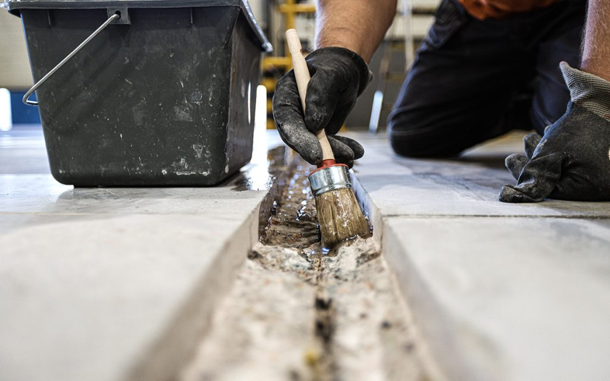

<!--
================================================================================
INSTRUKCJA EDYCJI ARTYKUŁU
================================================================================

HERO (główne zdjęcie):
- Wrzuć zdjęcie jako: docs/img/wiedza/SLUG/hero.jpg
- Wyświetli się automatycznie pod tytułem
- Pojawi się też w miniaturkach na liście artykułów
- Brak hero.jpg = brak zdjęcia głównego

ZDJĘCIA W TREŚCI:
- Placeholdery są na końcu pliku (przed "Powiązane artykuły")
- Wytnij, wklej gdzie chcesz, odkomentuj (usuń < ! - - i - - >)
- Zmień opis i numer pliku
- Wrzuć zdjęcia do: docs/img/wiedza/SLUG/
- Kompresja automatyczna przy renderze strony
- Rozmiar: { width="500" } lub { width="50%" }

DIAGRAMY (tylko szablony B i C):
- Edytuj tekst w bloku mermaid
- Zmień placeholdery: KROK 1, WYZWANIE, itd.
- Podgląd: https://mermaid.live

BLOKI WYRÓŻNIONE (admonitions):
- !!! note/tip/warning/danger/info/example "Tytuł"
- Treść z wcięciem 4 spacji (zaznacz + Tab)
- ??? = zwijane, ???+ = rozwinięte domyślnie

STRUKTURA:
- Wypełnij sekcje oznaczone [w nawiasach kwadratowych]
- Zachowaj hierarchię nagłówków (H2, H3)
- Usuń sekcje których nie potrzebujesz

STATUS W CSV:
- new = do wygenerowania
- draft = w edycji (niewidoczny na stronie)
- published = widoczny na stronie

PODGLĄD LOKALNY (tylko published):
python -m mkdocs serve

PODGLĄD Z DRAFTAMI (Windows):
set SHOW_DRAFTS=1 && python -m mkdocs serve

DEPLOY:
python -m mkdocs gh-deploy --clean --force
================================================================================
-->

# Remont istniejącej posadzki w zakładzie przemysłowym

{{ wiedza_hero("remont-posadzki-przemyslowej") }}

**Proces diagnostyki, naprawy i modernizacji posadzki przemysłowej z uwzględnieniem obciążeń technologicznych, dylatacji oraz systemów żywicznych.**

Dowiedz się, jak podejść do tego zagadnienia w kontekście projektowania obiektów przemysłowych.

---

## Problem projektowy

Remont istniejącej posadzki w zakładzie przemysłowym jest złożonym zadaniem technicznym, ponieważ prace muszą być prowadzone przy ograniczeniu przestojów produkcyjnych oraz przy zachowaniu kompatybilności z istniejącą konstrukcją płyty. W wielu obiektach posadzki ulegają degradacji w wyniku intensywnego ruchu wózków widłowych, przeciążeń punktowych, oddziaływania chemicznego lub błędów wykonawczych z wcześniejszych etapów inwestycji. Kluczowym wyzwaniem jest właściwa diagnoza przyczyn uszkodzeń oraz dobór technologii naprawy zapewniającej trwałość i bezpieczeństwo eksploatacji.

## Kontekst przemysłowy

W zakładach przemysłowych posadzka pełni funkcję elementu konstrukcyjnego i technologicznego jednocześnie. Musi przenosić duże obciążenia statyczne i dynamiczne, umożliwiać bezpieczny transport wewnętrzny oraz spełniać wymagania dotyczące odporności na ścieranie, środki chemiczne lub temperaturę. Modernizacja posadzki często odbywa się w działającym obiekcie produkcyjnym, co wymaga etapowania prac, odpowiedniego planowania logistyki oraz minimalizacji wpływu robót na ciągłość produkcji.

## Podejście projektowe

Rekomendowane podejście do remontu posadzki przemysłowej powinno opierać się na szczegółowej diagnostyce technicznej istniejącej płyty oraz analizie warunków jej dalszej eksploatacji. Kluczowe jest nie tylko rozpoznanie aktualnego stanu technicznego betonu i podłoża, ale również określenie rzeczywistych obciążeń, jakim posadzka będzie poddawana w trakcie użytkowania po remoncie. Na tej podstawie dobiera się technologię naprawy, zakres wzmocnienia konstrukcji oraz typ warstwy użytkowej.

W analizie projektowej warto rozdzielić dwa zasadnicze obszary: wymagania konstrukcyjne związane z przenoszeniem obciążeń oraz wymagania eksploatacyjne dotyczące powierzchni użytkowej posadzki.

### Wymagania konstrukcyjne (statyka i nośność)
!!! warning "Uwaga"

    Pierwszym krokiem jest ocena zdolności istniejącej płyty do przenoszenia obciążeń. Dotyczy to zarówno obciążeń stałych, jak i zmiennych pojawiających się w trakcie użytkowania obiektu. W szczególności należy rozpoznać:

    - obciążenia od składowania materiałów i regałów magazynowych,  
    - obciążenia od maszyn technologicznych oraz ich fundamentów,  
    - obciążenia dynamiczne związane z ruchem wózków widłowych lub transportu wewnętrznego,  
    - lokalne przeciążenia punktowe (np. podpory urządzeń, koła maszyn).

Na podstawie tych informacji ocenia się, czy istniejąca płyta może pozostać w eksploatacji po naprawie powierzchniowej, czy też konieczne jest jej wzmocnienie, wykonanie nadbetonu lub lokalna rekonstrukcja fragmentów posadzki.

### Wymagania eksploatacyjne (warstwa użytkowa)

Drugim obszarem analizy jest dobór odpowiedniej warstwy użytkowej posadzki, która musi być dostosowana do warunków środowiskowych i sposobu użytkowania hali. W praktyce należy uwzględnić m.in.:

- intensywność ruchu transportowego i wymagania dotyczące odporności na ścieranie,  
- oddziaływanie substancji chemicznych (oleje, smary, kwasy, środki czyszczące),  
- możliwość występowania środowiska agresywnego lub wilgotnego,  
- wymagania higieniczne lub technologiczne (np. łatwość czyszczenia, ograniczenie pylenia),  
- wymagania dotyczące antypoślizgowości lub właściwości elektrostatycznych.

Dopiero zestawienie wymagań konstrukcyjnych z wymaganiami eksploatacyjnymi pozwala dobrać właściwą technologię naprawy – od napraw punktowych i reprofilacji powierzchni, przez wykonanie nowych powłok żywicznych, aż po wykonanie nowych warstw użytkowych o podwyższonej odporności mechanicznej i chemicznej.
### Kluczowe założenia

- Remont powinien być poprzedzony szczegółową ekspertyzą techniczną i badaniami podłoża.
- Technologia naprawy musi być dopasowana do rzeczywistych obciążeń eksploatacyjnych.
- Harmonogram prac powinien minimalizować przestoje produkcyjne i ingerencję w logistykę zakładu.

### Etapy realizacji

1. Diagnostyka techniczna posadzki obejmująca analizę spękań, nośności, stanu dylatacji oraz badania wytrzymałościowe betonu.  
2. Opracowanie projektu technologii naprawy wraz z doborem materiałów i etapowaniem prac w funkcjonującym obiekcie.  
3. Wykonanie prac naprawczych obejmujących naprawę pęknięć, rekonstrukcję dylatacji, reprofilację powierzchni oraz ewentualne wykonanie nowej warstwy użytkowej.
 
{ width="70%" }

## Typowe błędy
!!! danger "WAŻNE"

    - **Naprawa bez wcześniejszej diagnostyki** — prowadzi do usunięcia jedynie objawów uszkodzeń, bez eliminacji ich przyczyn, co skutkuje szybkim powrotem problemów.  
    - **Niedostosowanie technologii do obciążeń eksploatacyjnych** — zbyt słaba warstwa naprawcza ulega ponownemu zniszczeniu pod wpływem ruchu transportowego lub obciążeń punktowych.  
    - **Ignorowanie dylatacji konstrukcyjnych** — nieprawidłowa naprawa lub ich zasłonięcie powoduje powstawanie nowych spękań i degradację posadzki.

## Wnioski dla inwestora

Remont posadzki przemysłowej powinien być traktowany jako projekt inżynierski wymagający analizy technicznej oraz właściwego planowania technologii robót. Odpowiednie przygotowanie procesu naprawy pozwala znacząco wydłużyć okres eksploatacji posadzki oraz ograniczyć koszty przyszłych napraw.

### Korzyści

- Wydłużenie trwałości posadzki i zwiększenie bezpieczeństwa eksploatacji.  
- Ograniczenie ryzyka przestojów produkcyjnych wynikających z uszkodzeń nawierzchni.  
- Poprawa parametrów użytkowych posadzki, w tym odporności na ścieranie i obciążenia transportowe.

<!-- ZDJĘCIA - odkomentuj i użyj gdzie potrzebujesz w artykule -->
<!--  -->
<!--  -->
<!--  -->

---

{{ wiedza_powiazane("remont-posadzki-przemyslowej") }}

  <a href="../" class="btn btn-outline">Powrót do centrum wiedzy</a>

