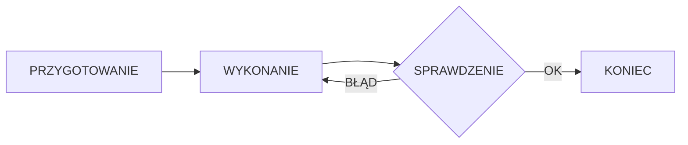

<!--
================================================================================
INSTRUKCJA EDYCJI ARTYKUŁU
================================================================================

HERO (główne zdjęcie):
- Wrzuć zdjęcie jako: docs/img/wiedza/SLUG/hero.jpg
- Wyświetli się automatycznie pod tytułem
- Pojawi się też w miniaturkach na liście artykułów
- Brak hero.jpg = brak zdjęcia głównego

ZDJĘCIA W TREŚCI:
- Placeholdery są na końcu pliku (przed "Powiązane artykuły")
- Wytnij, wklej gdzie chcesz, odkomentuj (usuń < ! - - i - - >)
- Zmień opis i numer pliku
- Wrzuć zdjęcia do: docs/img/wiedza/SLUG/
- Kompresja automatyczna przy renderze strony

DIAGRAMY (tylko szablony B i C):
- Edytuj tekst w bloku mermaid
- Zmień placeholdery: KROK 1, WYZWANIE, itd.
- Podgląd: https://mermaid.live

STRUKTURA:
- Wypełnij sekcje oznaczone [w nawiasach kwadratowych]
- Zachowaj hierarchię nagłówków (H2, H3)
- Usuń sekcje których nie potrzebujesz

STATUS W CSV:
- new = do wygenerowania
- draft = w edycji (niewidoczny na stronie)
- published = widoczny na stronie

DEPLOY:
python -m mkdocs gh-deploy --clean --force
================================================================================
-->

# Test losowania szablonu

{{ wiedza_hero("test-losowanie-szablonu") }}

Artykuł testowy do weryfikacji randomizacji szablonów generatora

---

## Co to jest?

[Wyjaśnij pojęcie lub zagadnienie]

!!! info "Definicja"
    [Krótka definicja terminu]

## Dlaczego to ważne?

[Uzasadnij znaczenie tematu]

### Korzyści

| Korzyść | Opis |
|---------|------|
| [Korzyść 1] | [Opis] |
| [Korzyść 2] | [Opis] |
| [Korzyść 3] | [Opis] |

## Jak to zrobić?

[Przedstaw instrukcję krok po kroku]

### Schemat działania

### Krok 1: [Nazwa]

[Opis kroku]

### Krok 2: [Nazwa]

[Opis kroku]

### Krok 3: [Nazwa]

[Opis kroku]

## Checklist

- [ ] [Zadanie 1]
- [ ] [Zadanie 2]
- [ ] [Zadanie 3]
- [ ] [Zadanie 4]
- [ ] [Zadanie 5]

!!! warning "Uwaga"
    [Najważniejsze ostrzeżenie lub wskazówka]

<!-- ZDJĘCIA - odkomentuj i użyj gdzie potrzebujesz w artykule -->
<!--  -->
<!--  -->
<!--  -->

---

{{ wiedza_powiazane("test-losowanie-szablonu") }}

  <a href="../" class="btn btn-outline">Powrót do centrum wiedzy</a>

